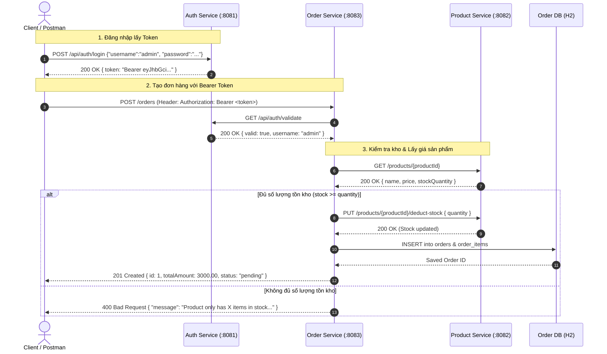
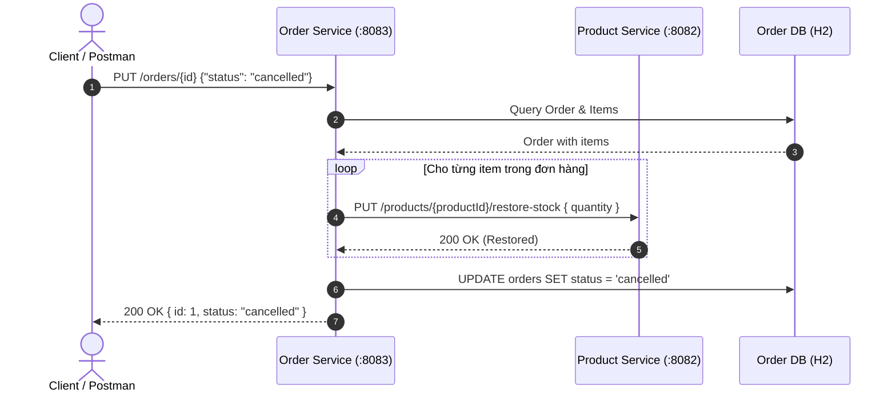

# Hệ Thống Quản Lý Đơn Hàng (Order Management System) - Kiến Trúc SOA

> **Bài Thực Hành Số 4:** Xây dựng dịch vụ quản lý đơn hàng (Order Management)  
> **Kiến trúc:** Service-Oriented Architecture (SOA) & Microservices  
> **Ngôn ngữ & Framework:** Java 21 LTS, Spring Boot 3.3.4, Spring Data JPA, Hibernate, OpenAPI Swagger UI, JJWT  

---

## 1. TỔNG QUAN KIẾN TRÚC SOA

Hệ thống được thiết kế theo đúng nguyên tắc **Dịch vụ độc lập (Autonomous Services)** của SOA:
- Mỗi dịch vụ sở hữu cơ sở dữ liệu riêng biệt (**Database per Service**), hoàn toàn không truy cập chéo DB.
- Các dịch vụ giao tiếp với nhau qua giao thức chuẩn **RESTful HTTP / JSON**.
- Bảo mật đồng bộ: Xác thực tập trung thông qua **Auth Service** bằng **JWT Bearer Token**, kiểm tra tính hợp lệ trước khi cho phép xử lý nghiệp vụ tại **Order Service**.
- Giao dịch bù trừ (Compensating Transactions / Saga pattern nhẹ): Tự động hoàn lại số lượng tồn kho bên **Product Service** khi hủy đơn hàng hoặc xóa item.

```text
order-management/
├── pom.xml                                   # Root Maven POM (Aggregator / Parent)
├── auth-service/                             # Port 8081: Xác thực & Sinh JWT (TH2)
│   ├── pom.xml
│   └── src/...
├── product-service/                          # Port 8082: Quản lý Sản phẩm & Kho hàng (TH3)
│   ├── pom.xml
│   └── src/...
├── order-service/                            # Port 8083: Nghiệp vụ Quản lý Đơn hàng (TH4 - Chính)
│   ├── pom.xml
│   └── src/...
├── run_all.bat                               # Script khởi động 3 services trên Windows
├── run_all.sh                                # Script khởi động nền & health-check trên Linux/macOS
├── stop_all.sh                               # Script dừng tất cả services
├── postman_or_curl_tests.sh                  # Script test tự động toàn bộ luồng nghiệp vụ
├── Order_Management_SOA.postman_collection.json # File import Postman Collection v2.1
└── README.md                                 # Tài liệu kiến trúc và hướng dẫn vận hành
```

---

## 2. VAI TRÒ CỦA CÁC SERVICE TRONG HỆ THỐNG

| Service | Port | Database | Nhiệm vụ chính |
| :--- | :---: | :---: | :--- |
| **Auth Service** | `8081` | In-Memory / JWT Key | Xác thực người dùng (`POST /api/auth/login`), sinh mã JWT Token (HMAC-SHA256) và cung cấp API xác thực token (`GET /api/auth/validate`) cho các service nội bộ. |
| **Product Service** | `8082` | H2 (`product_db`) | Quản lý danh mục sản phẩm, đơn giá và số lượng tồn kho. Cung cấp API kiểm tra thông tin (`GET /products/{id}`), trừ kho (`PUT /products/{id}/deduct-stock`) và hoàn kho (`PUT /products/{id}/restore-stock`). |
| **Order Service** | `8083` | H2 (`order_db`) | **Dịch vụ trọng tâm**: Tiếp nhận đơn hàng, tích hợp `AuthFilter` để bảo vệ API bằng Bearer Token, kiểm tra tồn kho & lấy đơn giá từ Product Service, tính toán tổng tiền, lưu đơn hàng (`orders`) và các mặt hàng (`order_items`). |

---

## 3. SƠ ĐỒ TƯƠNG TÁC SOA (SEQUENCE DIAGRAMS)

### 3.1. Luồng Xác Thực và Tạo Đơn Hàng Thành Công



### 3.2. Luồng Hủy Đơn Hàng / Xóa Order Item (Hoàn Kho Bù Trừ)



---

## 4. THIẾT KẾ CƠ SỞ DỮ LIỆU (DATABASE SCHEMA)

### 4.1. Dịch vụ Đơn Hàng (`order-service`) - Database: `order_db`

```sql
-- Bảng orders: Quản lý thông tin đơn hàng
CREATE TABLE orders (
    id BIGINT AUTO_INCREMENT PRIMARY KEY,
    customer_name VARCHAR(255) NOT NULL,
    customer_email VARCHAR(255) NOT NULL,
    total_amount DECIMAL(10, 2) NOT NULL DEFAULT 0.00,
    status VARCHAR(50) NOT NULL DEFAULT 'pending', -- pending, completed, cancelled
    created_at TIMESTAMP NOT NULL,
    updated_at TIMESTAMP
);

-- Bảng order_items: Chi tiết các mặt hàng trong đơn
CREATE TABLE order_items (
    id BIGINT AUTO_INCREMENT PRIMARY KEY,
    order_id BIGINT NOT NULL,
    product_id BIGINT NOT NULL,
    product_name VARCHAR(255) NOT NULL,
    quantity INT NOT NULL,
    unit_price DECIMAL(10, 2) NOT NULL,
    total_price DECIMAL(10, 2) NOT NULL,
    CONSTRAINT fk_order_items_order FOREIGN KEY (order_id) REFERENCES orders(id) ON DELETE CASCADE
);
```

### 4.2. Dịch vụ Sản Phẩm (`product-service`) - Database: `product_db`

```sql
CREATE TABLE products (
    id BIGINT AUTO_INCREMENT PRIMARY KEY,
    name VARCHAR(255) NOT NULL,
    description VARCHAR(1000),
    price DECIMAL(10, 2) NOT NULL,
    stock_quantity INT NOT NULL DEFAULT 0,
    category VARCHAR(100)
);
```

*Dữ liệu mẫu khởi tạo trong `product-service`:*
1. **Laptop Dell XPS 15** - Giá: `$1500.00` - Tồn kho: `10`
2. **iPhone 15 Pro Max** - Giá: `$1200.00` - Tồn kho: `5`
3. **Mechanical Keyboard Keychron Q1** - Giá: `$180.00` - Tồn kho: `25`
4. **Wireless Mouse Logitech MX Master 3S** - Giá: `$99.00` - Tồn kho: `3`
5. **Dell UltraSharp 27 Monitor 4K** - Giá: `$450.00` - Tồn kho: `0` *(Out of stock phục vụ test lỗi)*

---

## 5. ĐẶC TẢ CHI TIẾT CÁC RESTFUL API

### 5.1. Auth Service (`http://localhost:8081`)

| Method | Endpoint | Quyền | Mô tả |
| :--- | :--- | :--- | :--- |
| `POST` | `/api/auth/login` | Public | Đăng nhập lấy Bearer JWT Token (`admin` / `admin123` hoặc `john_doe` / `password123`) |
| `GET` | `/api/auth/validate` | Internal/Public | Xác thực token qua header `Authorization: Bearer <token>` |
| `GET` | `/api/auth/me` | Bearer | Lấy thông tin user hiện tại |
| `GET` | `/api/auth/health` | Public | Health check |

### 5.2. Product Service (`http://localhost:8082`)

| Method | Endpoint | Mô tả |
| :--- | :--- | :--- |
| `GET` | `/products` | Lấy danh sách tất cả sản phẩm |
| `GET` | `/products/{id}` | Lấy chi tiết sản phẩm theo ID |
| `PUT` | `/products/{id}/deduct-stock` | Trừ tồn kho: Body `{"quantity": 2}` hoặc param `?quantity=2` |
| `PUT` | `/products/{id}/restore-stock` | Hoàn trả tồn kho: Body `{"quantity": 2}` |
| `POST` | `/products` | Thêm sản phẩm mới |
| `PUT` | `/products/{id}` | Cập nhật thông tin sản phẩm |
| `DELETE` | `/products/{id}` | Xóa sản phẩm |
| `GET` | `/products/health` | Health check |

### 5.3. Order Service (`http://localhost:8083`) *(Tất cả yêu cầu Bearer Token)*

#### Nhóm Quản lý Đơn hàng (Orders):
| Method | Endpoint | Request Body | Mô tả |
| :--- | :--- | :--- | :--- |
| `GET` | `/orders` | None | Lấy danh sách tất cả đơn hàng |
| `GET` | `/orders/{id}` | None | Lấy thông tin chi tiết một đơn hàng (kèm danh sách `items`) |
| `POST` | `/orders` | `CreateOrderRequest` | Tạo đơn hàng mới (tự động kiểm tra tồn kho & trừ kho) |
| `PUT` | `/orders/{id}` | `{"status": "completed"}` | Cập nhật trạng thái (`pending`, `completed`, `cancelled`) |
| `DELETE` | `/orders/{id}` | None | Xóa đơn hàng (cascade xóa items, hoàn kho nếu đang pending) |
| `GET` | `/orders/health` | None | Public health check |

#### Nhóm Quản lý Mặt hàng (Order Items):
| Method | Endpoint | Request Body | Mô tả |
| :--- | :--- | :--- | :--- |
| `GET` | `/order_items` | None | Lấy danh sách tất cả mặt hàng trong hệ thống |
| `GET` | `/order_items/{id}` | None | Lấy chi tiết một mặt hàng |
| `POST` | `/order_items` | `{"orderId": 1, "productId": 3, "quantity": 1}` | Thêm mặt hàng mới vào đơn hàng (trừ kho & tính lại tổng tiền) |
| `PUT` | `/order_items/{id}` | `{"quantity": 2}` | Cập nhật số lượng (tự động trừ/bù tồn kho & tính lại tổng tiền) |
| `DELETE` | `/order_items/{id}` | None | Xóa mặt hàng khỏi đơn hàng (hoàn kho & tính lại tổng tiền) |

---

## 6. CHUẨN HÓA DỮ LIỆU & XỬ LÝ LỖI (EXCEPTION HANDLING)

Tất cả phản hồi từ API đều tuân thủ cấu trúc thống nhất `ApiResponse<T>`:

```json
{
  "timestamp": "2026-11-09T11:00:00.000",
  "status": 200,
  "message": "Thao tác thành công",
  "data": { ... }
}
```

Khi có lỗi xảy ra, `@RestControllerAdvice` (`GlobalExceptionHandler`) xử lý tập trung:
- **`400 Bad Request`**: Dữ liệu không hợp lệ (Validation fail) hoặc số lượng tồn kho không đủ (`InsufficientStockException`).
- **`401 Unauthorized`**: Token không có, không đúng định dạng Bearer hoặc đã hết hạn.
- **`404 Not Found`**: Không tìm thấy đơn hàng, item hoặc sản phẩm (`ResourceNotFoundException`).
- **`503 Service Unavailable`**: Dịch vụ phụ thuộc (`auth-service` hoặc `product-service`) bị ngắt kết nối.

---

## 7. HƯỚNG DẪN CÀI ĐẶT & VẬN HÀNH

### 7.1. Yêu cầu môi trường
- **Java Development Kit (JDK):** Java 21 LTS trở lên (`java -version`).
- **Apache Maven:** Phiên bản 3.8+ trở lên (`mvn -v`).
- **cURL & jq:** Dùng để chạy script test tự động trên terminal.

### 7.2. Build toàn bộ hệ thống
Tại thư mục gốc `order-management/`:
```bash
mvn clean package -DskipTests
```
Lệnh này sẽ tự động biên dịch và đóng gói cả 3 microservice thành các file thực thi `.jar`:
- `auth-service/target/auth-service-1.0.0.jar`
- `product-service/target/product-service-1.0.0.jar`
- `order-service/target/order-service-1.0.0.jar`

### 7.3. Khởi chạy hệ thống

#### Cách 1: Trên Windows (Khởi chạy bằng file Batch)
Nhấp đúp chuột hoặc mở CMD chạy file:
```cmd
run_all.bat
```
*Script sẽ mở 3 cửa sổ Command Prompt riêng biệt cho Auth Service, Product Service và Order Service.*

#### Cách 2: Trên Linux / macOS (Khởi chạy bằng Shell Script)
```bash
chmod +x run_all.sh stop_all.sh postman_or_curl_tests.sh
./run_all.sh
```
*Script sẽ tự động giải phóng port nếu bị chiếm dụng, khởi động ngầm 3 service, ghi log vào thư mục `logs/` và kiểm tra readiness qua polling.*

Để dừng các service:
```bash
./stop_all.sh
# Hoặc: ./run_all.sh stop
```

---

## 8. HƯỚNG DẪN KIỂM THỬ HỆ THỐNG (TESTING)

### 8.1. Kiểm thử tự động bằng Shell Script (End-to-End)
Sau khi đã chạy 3 service, chạy lệnh sau:
```bash
./postman_or_curl_tests.sh
```
Script sẽ tự động thực hiện **26 bước kiểm thử logic toàn diện**, bao gồm:
1. Health check cả 3 services.
2. Kiểm tra chặn 401 Unauthorized khi không có hoặc truyền sai Bearer Token.
3. Đăng nhập Auth Service lấy JWT token và validate token.
4. Kiểm tra danh mục sản phẩm bên Product Service.
5. Tạo đơn hàng thành công khi đủ tồn kho và kiểm tra trừ kho tự động.
6. Thử tạo đơn hàng vượt quá tồn kho (kiểm tra ném lỗi 400 Bad Request).
7. Lấy chi tiết đơn hàng và danh sách đơn hàng.
8. Thêm item mới vào đơn hàng (kiểm tra trừ kho và tính lại tổng tiền đơn hàng).
9. Cập nhật số lượng item (kiểm tra điều chỉnh kho và tính lại tổng tiền).
10. Xóa item khỏi đơn hàng (kiểm tra hoàn kho và tính lại tổng tiền).
11. Cập nhật trạng thái đơn hàng sang `completed`.
12. Xóa đơn hàng và xác nhận đơn hàng đã bị xóa (404 Not Found).

### 8.2. Kiểm thử bằng Postman
1. Mở phần mềm **Postman**.
2. Nhấn nút **Import** -> Chọn file `Order_Management_SOA.postman_collection.json`.
3. Collection đã được cài đặt sẵn các biến môi trường và script tự động lưu `jwt_token`, `order_id`, `item_id`.
4. Nhấn **Run Collection** để chạy toàn bộ luồng tự động hoặc gọi từng request theo thứ tự 1 -> 2 -> 3 -> 4.

### 8.3. Kiểm thử qua Swagger UI
Mở trình duyệt truy cập:
- **Auth Service:** [http://localhost:8081/swagger-ui.html](http://localhost:8081/swagger-ui.html)
- **Product Service:** [http://localhost:8082/swagger-ui.html](http://localhost:8082/swagger-ui.html)
- **Order Service:** [http://localhost:8083/swagger-ui.html](http://localhost:8083/swagger-ui.html)  
  *(Nhấn nút **Authorize** màu xanh góc phải trên Swagger UI của Order Service và dán token JWT để test trực tiếp).*

### 8.4. Kiểm tra Cơ sở dữ liệu H2 Web Console
- **Order Service DB:** [http://localhost:8083/h2-console](http://localhost:8083/h2-console)  
  - JDBC URL: `jdbc:h2:mem:order_db`
  - User: `sa`
  - Password: *(để trống)*
- **Product Service DB:** [http://localhost:8082/h2-console](http://localhost:8082/h2-console)  
  - JDBC URL: `jdbc:h2:mem:product_db`
  - User: `sa`
  - Password: *(để trống)*

---

## 9. CÁC LỆNH CURL MẪU TEST THỦ CÔNG TỪ A - Z

```bash
# 1. Đăng nhập lấy JWT Bearer Token từ Auth Service
TOKEN=$(curl -s -X POST "http://localhost:8081/api/auth/login" \
  -H "Content-Type: application/json" \
  -d '{"username":"admin","password":"admin123"}' | jq -r '.data.token')
echo "Token: $TOKEN"

# 2. Xem danh sách sản phẩm bên Product Service
curl -s -X GET "http://localhost:8082/products" | jq

# 3. Tạo đơn hàng mới bên Order Service (Kèm Bearer Token)
curl -s -X POST "http://localhost:8083/orders" \
  -H "Content-Type: application/json" \
  -H "Authorization: Bearer $TOKEN" \
  -d '{
    "customerName": "Nguyen Van An",
    "customerEmail": "an.nguyen@example.com",
    "items": [
      {
        "productId": 1,
        "quantity": 2
      }
    ]
  }' | jq

# 4. Lấy chi tiết đơn hàng vừa tạo (ID: 1)
curl -s -X GET "http://localhost:8083/orders/1" \
  -H "Authorization: Bearer $TOKEN" | jq

# 5. Thêm một sản phẩm mới vào đơn hàng (Order Item)
curl -s -X POST "http://localhost:8083/order_items" \
  -H "Content-Type: application/json" \
  -H "Authorization: Bearer $TOKEN" \
  -d '{
    "orderId": 1,
    "productId": 3,
    "quantity": 1
  }' | jq

# 6. Cập nhật số lượng của Order Item vừa thêm (Ví dụ Item ID: 2 lên 2 cái)
curl -s -X PUT "http://localhost:8083/order_items/2" \
  -H "Content-Type: application/json" \
  -H "Authorization: Bearer $TOKEN" \
  -d '{"quantity": 2}' | jq

# 7. Xóa Order Item khỏi đơn hàng (Tự động hoàn kho cho Product Service)
curl -s -X DELETE "http://localhost:8083/order_items/2" \
  -H "Authorization: Bearer $TOKEN" | jq

# 8. Cập nhật trạng thái đơn hàng sang 'completed'
curl -s -X PUT "http://localhost:8083/orders/1" \
  -H "Content-Type: application/json" \
  -H "Authorization: Bearer $TOKEN" \
  -d '{"status": "completed"}' | jq

# 9. Xóa đơn hàng
curl -s -X DELETE "http://localhost:8083/orders/1" \
  -H "Authorization: Bearer $TOKEN" | jq
```

